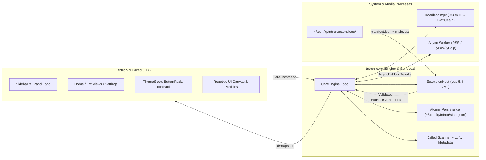
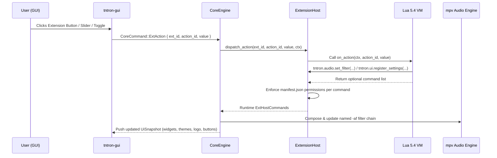
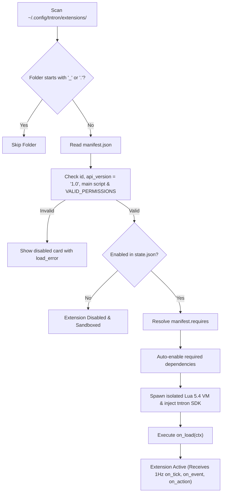
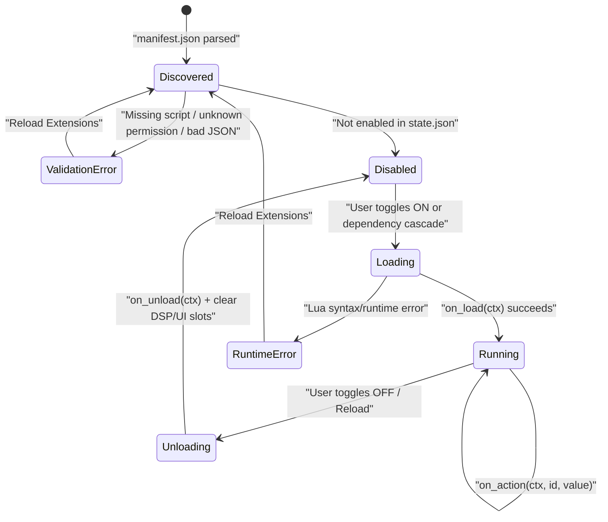

# tntron Extension Developer & API Guide

Welcome to the **tntron Extension SDK (API v1.0)**.
tntron embeds a sandboxed **Lua 5.4** engine inside `tntron-core` (`extensions.rs` / `ext_api.rs`), giving extensions declarative UI, theme/logo customization, real-time audio DSP chains (`mpv -af`), playback control, library inspection, persistent storage, and optional network access — all governed by a strict **default-deny permission model**.

---

## Table of Contents

1. [System & Runtime Architecture](#1-system--runtime-architecture)
2. [Discovery, Validation & Dependency Cascade](#2-discovery-validation--dependency-cascade)
3. [Permission Model (Default-Deny)](#3-permission-model-default-deny)
4. [Extension Lifecycle State Machine](#4-extension-lifecycle-state-machine)
5. [Folder Anatomy & Quickstart Template](#5-folder-anatomy--quickstart-template)
6. [Complete `tntron.*` Lua API Reference](#6-complete-tntron-lua-api-reference)
7. [Declarative UI Widgets (`tntron.ui`)](#7-declarative-ui-widgets-tntronui)
8. [Theming, Brand Logo & Style Hooks](#8-theming-brand-logo--style-hooks)
9. [Events, Async Jobs & `.tnt` Preset Format](#9-events-async-jobs--tnt-preset-format)
10. [Complete Worked Example Extension](#10-complete-worked-example-extension)

---

## 1. System & Runtime Architecture



### Action & Event Sequence



---

## 2. Discovery, Validation & Dependency Cascade

On startup (and whenever **Reload Extensions** is clicked), `ExtensionHost::discover` scans `~/.config/tntron/extensions/`. Folders starting with `_` or `.` (such as `_template/`) are ignored.



### Dependency Rules
- **`requires`**: List extension IDs your extension depends on (e.g. `["tntron.lyrics"]`). Enabling your extension automatically enables its dependencies; disabling a dependency cascades and disables dependents cleanly.
- **`used_by`**: Automatically populated on `ExtensionCardInfo` so users know what relies on an extension before disabling it.
- **Zero-Extension Safety**: When extensions are disabled, `CoreEngine::reconcile_ext_owned_state` resets extension-owned overrides (Reactive UI overlays, Custom Button Packs, Icon overrides, Custom Logo overrides, Transparency overlays, Popup Player) back to defaults so the base player always stays functional and clean.

---

## 3. Permission Model (Default-Deny)

Every Lua extension executes inside its own isolated `mlua` Lua 5.4 VM (`Lua::new()`, stdlib subset with `ALL_SAFE`, blocking raw OS shell/arbitrary filesystem libraries). Every host call validates the extension's `manifest.json` `permissions` array at runtime:

| Permission | Unlocks APIs | Security Scope |
|---|---|---|
| `playback:read` | `tntron.playback.get()` | Read-only track state, codec, position, volume, speed |
| `playback:control` | `toggle`, `play`, `pause`, `next`, `prev`, `seek`, `seek_relative`, `set_volume`, `set_speed`, `set_mute`, `play_path` | Transport controls (`play_path` permits jailed files or `http(s)` audio URLs) |
| `queue:control` | `tntron.queue.list()`, `add()`, `clear()` | Read & manipulate playback queue |
| `library:read` | `tntron.library.current_folder()`, `all_tracks()`, `folders()`, `favorites()`, `rescan()`, `tntron.lyrics.load()` | Read-only access inside configured music root |
| `audio:dsp` | `tntron.audio.set_filter()`, `clear_filter()`, `set_spatial()`, `set_pitch()` | Composes named mpv `-af` stages cleanly with other extensions |
| `fs:write` | `tntron.fs.create_folder()`, `delete_folder()`, `copy_to_folder()`, `delete_file()` | **Strictly jailed** inside the user's Music Root (path traversal blocked) |
| `ui:sidebar` | `tntron.ui.register_sidebar()`, `unregister_sidebar()`, `open_sidebar()`, `set_compact_menu()`, style configs | Adds sidebar navigation tab + renders extension view |
| `ui:settings` | `tntron.ui.register_settings()`, `set_density()`, `set_layout()`, config setters, `tntron.extensions.set_all()` | Renders settings panel inside **Settings -> Extension Settings** |
| `ui:topbar` | `tntron.ui.set_topbar_slot()`, `clear_topbar_slot()` | Displays interactive badge in top bar |
| `ui:player_widget` | `tntron.ui.set_player_widget()`, `clear_player_widget()` | Displays widget pill inside bottom player bar |
| `themes:register` | `tntron.themes.register()`, `tntron.themes.set_active()`, `tntron.ui.set_logo_config()` | Registers custom palettes & customizes the theme brand logo |
| `storage` | `tntron.storage.get(key, default)`, `tntron.storage.set(key, val)` | Namespaced atomic key-value JSON map inside `state.json` |
| `notify` | `tntron.ui.toast(msg)`, `tntron.notify.desktop(summary, body)` | In-app toast banners and OS desktop notifications |
| `network` | `tntron.net.fetch_rss()`, `yt_search()`, `yt_play()`, `yt_download()` (also requires `fs:write`) | Async HTTP/RSS/yt-dlp workers |

---

## 4. Extension Lifecycle State Machine



---

## 5. Folder Anatomy & Quickstart Template

Place your extension at `~/.config/tntron/extensions/<my-extension>/` (tntron automatically seeds `~/.config/tntron/extensions/_template/` on first launch):

```text
~/.config/tntron/extensions/
├── _template/                 # Reference starter (skipped by loader)
│   ├── API.md
│   ├── manifest.json
│   └── main.lua
└── my-extension/
    ├── manifest.json          # Metadata + capability permissions
    └── main.lua               # Lua 5.4 entry script
```

### `manifest.json` Schema

```json
{
  "id": "author.my-extension",
  "name": "My Extension",
  "version": "1.0.0",
  "api_version": "1.0",
  "description": "What your extension adds to tntron.",
  "author": "Your Name",
  "main": "main.lua",
  "permissions": ["playback:read", "ui:settings", "storage", "notify"],
  "requires": []
}
```

> [!IMPORTANT]
> Always set `"api_version": "1.0"` and ensure `id` is globally unique (reverse-domain style such as `yourname.feature-name`).

---

## 6. Complete `tntron.*` Lua API Reference

### `tntron.playback`
- `tntron.playback.get()` -> `{ playing, paused, stopped, muted, position_sec, duration_sec, volume, speed, shuffle, loop_mode, codec, title, artist, album, track_path }`
- `tntron.playback.toggle()`, `.play()`, `.pause()`, `.next()`, `.prev()`
- `tntron.playback.seek(seconds)` / `tntron.playback.seek_relative(delta_seconds)`
- `tntron.playback.set_volume(percent_0_to_100)` / `.set_speed(0.25_to_3.0)` / `.set_mute(bool)`
- `tntron.playback.play_path(path_or_url)`

### `tntron.queue`
- `tntron.queue.list()` -> Array of `{ title, artist, album, path, duration_sec }`
- `tntron.queue.add(path_or_url)`
- `tntron.queue.clear()`

### `tntron.library` & `tntron.lyrics`
- `tntron.library.current_folder()` / `tntron.library.all_tracks()` / `tntron.library.folders()` / `tntron.library.favorites()` / `tntron.library.rescan()`
- `tntron.lyrics.load(path, title, artist, duration_sec, provider?)` (triggers async `"lyricsLoaded"` event)

### `tntron.audio`
- `tntron.audio.set_filter(mpv_af_string)` — Assigns a sandboxed named DSP filter stage (for example `"equalizer=f=60:t=q:w=1.2:g=4"`). tntron composes active filter stages from multiple extensions safely without overwriting core DSP or other plugins.
- `tntron.audio.clear_filter()` — Removes this extension's filter stage.
- `tntron.audio.set_spatial(preset, width)` / `tntron.audio.set_pitch(semitones, preserve_formant)`

### `tntron.fs` (Jailed Inside Music Root)
- `tntron.fs.create_folder(name)`
- `tntron.fs.copy_to_folder(track_path, folder_path)`
- `tntron.fs.delete_file(path)` / `tntron.fs.delete_folder(path)`

### `tntron.storage`
- `tntron.storage.get(key, default_value)`
- `tntron.storage.set(key, value)` (automatically persisted in `state.json`)

### `tntron.notify` & `tntron.extensions`
- `tntron.ui.toast(message)`
- `tntron.notify.desktop(summary, body)`
- `tntron.extensions.list()` — Inspect installed extension states
- `tntron.extensions.set_all(enabled)` — Enable/disable extension packs cleanly

### `tntron.net`
- `tntron.net.fetch_rss(url)` -> Emits `"rssFetched"`
- `tntron.net.yt_search(query)` -> Emits `"ytSearch"`
- `tntron.net.yt_play(url, title?)` -> Streams audio & emits `"ytPlaying"`
- `tntron.net.yt_download(url)` -> Saves inside music root & emits `"ytDownloaded"`

---

## 7. Declarative UI Widgets (`tntron.ui`)

Extensions compose native GPU-accelerated views cleanly without touching Rust code:

```lua
tntron.ui.register_settings({
    id = "my-panel",
    title = "My Extension Settings",
    widgets = {
        tntron.ui.heading("Section Title"),
        tntron.ui.text("Helpful caption", true), -- true = muted secondary text
        tntron.ui.row({
            tntron.ui.badge("LIVE", { icon = "wave", accent = true }),
            tntron.ui.button("do_thing", "Run Action", { icon = "play", active = true }),
        }),
        tntron.ui.toggle("enable_feat", "Enable Feature", true),
        tntron.ui.slider("gain", "Boost", -12, 12, 0.5, 3.0, "dB"),
        tntron.ui.progress("Progress", 42, 100),
        tntron.ui.input("filter", "Filter", "", {
            placeholder = "Type value...",
            submit_action = "apply_filter",
            submit_label = "Apply",
        }),
        tntron.ui.visualizer("bars", { playing = true, volume = 80, speed = 1.0 }),
    },
})
```

### Supported Container & Interactive Builders
- **Chrome Registration**: `register_sidebar({ id, label, icon, widgets })`, `unregister_sidebar(id)`, `open_sidebar(id)`, `register_settings({ id?, title, widgets })`, `set_topbar_slot({ text, icon?, accent?, action_id? })`, `set_player_widget(...)`
- **Primitives**: `heading(text)`, `text(text, muted?)`, `badge(text, { icon?, accent? })`, `row(children)`, `grid(columns, children)`, `card({ title, subtitle?, eyebrow?, icon?, badge?, variant?, accent?, active? })`
- **Inputs & Controls**: `button(action_id, label, { icon?, accent?, active? })`, `toggle(action_id, label, value)`, `slider(action_id, label, min, max, step, value, unit?)`, `progress(label, value, max)`, `input(input_id, label, value?, { placeholder?, submit_action?, submit_label? })`, `visualizer(mode, opts)`
- **Clipboard Sharing**: `tntron.ui.copy_clipboard(str)` and `tntron.ui.request_clipboard_paste()` (triggers `on_action(ctx, "clipboard_paste", pasted_text)`)

### Available Built-In Fonticon Names
`home`, `settings`, `library`, `music`, `disc`, `search`, `folder`, `star`, `play`, `pause`, `prev`, `next`, `shuffle`, `repeat`, `volume`, `mute`, `queue`, `plus`, `close`, `refresh`, `sliders`, `puzzle`, `clock`, `alert`, `bookmark`, `bell`, `download`, `rss`, `lyrics`, `wave`, `palette`, `globe`, `headphones`, `layers`, `chart`

---

## 8. Theming, Brand Logo & Style Hooks

Every theme in tntron integrates the `tntron-logo.svg` emblem automatically. Themes registered via `tntron.themes.register` receive a matching `logo_color` (defaulting to `accent` when omitted):

```lua
tntron.themes.register({
    slug = "midnight-emerald",
    label = "Midnight Emerald",
    base = "#080c0a",
    sidebar = "#0f1713",
    main = "#101914",
    card = "#16241d",
    card_hover = "#1e3228",
    text = "#ecfdf5",
    text_sub = "#9ca3af",
    accent = "#10b981",
    logo_color = "#34d399", -- Optional override for the dissolving tntron mark
})
```

### Live Style Configuration Patchers
- **`tntron.ui.set_logo_config(patch)`**: `{ enabled, mode = "themed"|"monochrome"|"custom_color"|"custom_image", custom_hex, custom_path, frame_style = "clean"|"badge"|"glow", size_px, beat_pulse }`
- **`tntron.ui.set_button_config(patch)`**: Customize `preset`, per-corner `round_tl/tr/br/bl`, `crop_tl/tr/br/bl`, `crop_size`, `hue_shift_deg`, `outline_*`, `inline_glow`, `outer_glow`, `bevel_emboss`, `gradient_*`, and `reactive_hover`
- **`tntron.ui.set_reactive_config(patch)`**: Control background mode, `glow_particles`, `glow_particle_style` (`"spiral"`, `"infinity8"`, `"anime_speed_lines"`, `"bubbles"`, `"glowy"`, `"flare"`, `"glamour"`, `"aurora"`, `"custom_sprite"`), colors, intensity, and custom sprite `.svg`/`.png`/`.jxl` path
- **`tntron.ui.set_icon_config(patch)`**: Switch bundled icon packs or load custom `.ttf`/`.otf` font files
- **`tntron.ui.set_transparency_config(patch)`**: Adjust `base_alpha`, `surface_alpha`, `card_alpha`, `custom_bg_path`, and Focus Mode (`hide_ui`)
- **`tntron.ui.set_layout_config(patch)`** & **`tntron.ui.set_popup_config(patch)`**

---

## 9. Events, Async Jobs & `.tnt` Preset Format

### Lifecycle Hooks Your Script May Export

| Hook | Trigger |
|---|---|
| `on_load(ctx)` | Extension activated or reloaded |
| `on_unload(ctx)` | Extension disabled or before hot-reload |
| `on_tick(ctx)` | Once per second (1 Hz) while active |
| `on_action(ctx, action_id, val)` | User interacted with widget (`button`, `toggle`, `slider`, `input`) or clipboard paste completed |
| `on_event(ctx, name, payload)` | `"trackChange"`, `"playbackStateChange"`, `"lyricsLoaded"`, `"rssFetched"`, `"ytSearch"`, `"ytPlaying"`, `"ytDownloaded"` |

### `.tnt` Share & Bundle Envelopes

tntron standardizes shareable settings as pretty JSON files with a versioned header:

```json
{
  "tnt_format": "tntron-buttons-v1",
  "name": "cyberpunk-preset",
  "config": {
    "enabled": true,
    "preset": "cyberpunk",
    "crop_tr": true,
    "crop_bl": true,
    "crop_size": 10.0,
    "reactive_hover": true
  }
}
```

Supported `tnt_format` headers:
- `tntron-full-v1` — Complete `PersistentState` (themes, logo, buttons, icons, reactive UI, layout, DSP, transparency, popup config) + installed user extension files
- `tntron-reactive-v1` — Reactive UI & Glow Particles preset
- `tntron-buttons-v1` — Button Packs preset
- `tntron-profile-v1` — Profile metadata + optional listening statistics (protected by one-time import approval prompt)

---

## 10. Complete Worked Example Extension

Create `~/.config/tntron/extensions/warm-studio/manifest.json`:

```json
{
  "id": "demo.warm-studio",
  "name": "Warm Studio",
  "version": "1.0.0",
  "api_version": "1.0",
  "description": "Registers a Warm Amber theme with a glowing custom logo and gentle tube-warmth DSP.",
  "author": "You",
  "main": "main.lua",
  "permissions": [
    "playback:read",
    "audio:dsp",
    "themes:register",
    "ui:settings",
    "storage",
    "notify"
  ],
  "requires": []
}
```

Create `~/.config/tntron/extensions/warm-studio/main.lua`:

```lua
local state = { warmth = 3.0, glow_logo = true }

local THEME = {
    slug = "warm-studio",
    label = "Warm Studio",
    base = "#0f0a06",
    sidebar = "#19110a",
    main = "#140d08",
    card = "#24180f",
    card_hover = "#322216",
    text = "#fef3c7",
    text_sub = "#d97706",
    accent = "#f59e0b",
    logo_color = "#fbbf24",
}

local function apply_dsp()
    if state.warmth > 0 then
        local af = string.format("equalizer=f=110:t=q:w=0.9:g=%.1f", state.warmth)
        tntron.audio.set_filter(af)
    else
        tntron.audio.clear_filter()
    end
end

local function render()
    tntron.ui.register_settings({
        id = "warm-studio",
        title = "Warm Studio",
        widgets = {
            tntron.ui.heading("Theme & Logo"),
            tntron.ui.row({
                tntron.ui.button("apply_theme", "Activate Warm Studio Theme", { icon = "palette", accent = true }),
                tntron.ui.toggle("glow_logo", "Glowing Brand Logo", state.glow_logo),
            }),
            tntron.ui.slider("warmth", "Low-Mid Tube Warmth", 0, 8, 0.5, state.warmth, "dB"),
        },
    })
end

function on_load(_ctx)
    state.warmth = tntron.storage.get("warmth", 3.0)
    state.glow_logo = tntron.storage.get("glow_logo", true)
    tntron.themes.register(THEME)
    apply_dsp()
    render()
end

function on_action(_ctx, id, val)
    if id == "apply_theme" then
        tntron.themes.set_active("warm-studio")
        tntron.ui.set_logo_config({
            mode = "themed",
            frame_style = state.glow_logo and "glow" or "clean",
            beat_pulse = true,
        })
        tntron.ui.toast("Activated Warm Studio theme & logo")
    elseif id == "glow_logo" then
        state.glow_logo = (val == true)
        tntron.storage.set("glow_logo", state.glow_logo)
        tntron.ui.set_logo_config({ frame_style = state.glow_logo and "glow" or "clean" })
    elseif id == "warmth" then
        local n = tonumber(val)
        if n then
            state.warmth = n
            tntron.storage.set("warmth", n)
            apply_dsp()
        end
    end
    render()
end

function on_unload(_ctx)
    tntron.audio.clear_filter()
end
```

Enable **Warm Studio** in **Settings -> Extensions**, switch to **Extension Settings**, and click **Activate Warm Studio Theme**!
